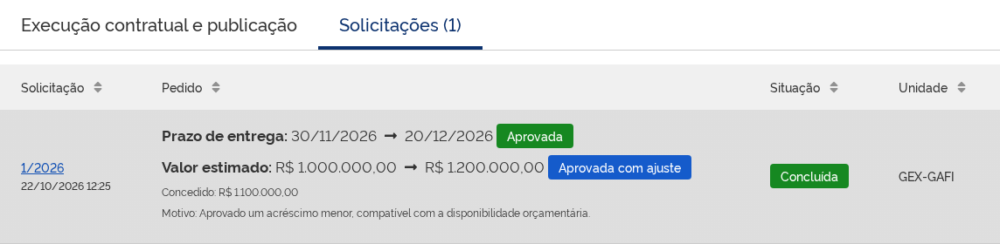

# Acompanhar o andamento

## A situação do item

Cada item tem uma **situação**, mostrada por uma etiqueta colorida na lista de Processos e na ficha
do item:

| Situação | O que quer dizer |
|---|---|
| **No prazo** | O processo ainda vai ser entregue à Gelic e o prazo de entrega não passou |
| **Atrasado** | O prazo de entrega à Gelic passou e o processo ainda não foi entregue |
| **Em tramitação** | O processo já foi entregue à Gelic e a contratação está em andamento |
| **Concluído** | A contratação foi concluída |
| **Cancelado** | O item saiu do PCA |

A situação acompanha o andamento do item: a equipe do PCA a atualiza (inclusive nas reuniões
mensais de acompanhamento) e o sistema acompanha os processos no SEI. Quando o prazo de entrega passa
sem a entrega, o item aparece como **Atrasado** sem que ninguém precise mudar nada.

## O prazo de entrega

O **prazo de entrega** é a data combinada para a unidade entregar o processo do item à Gelic. Para
ver o prazo vigente de um item da sua unidade, abra um pedido de alteração do item: a tela mostra o
**prazo de entrega atual**, o mês previsto e o valor estimado (veja [Solicitações](solicitacoes.md)).
Se o prazo precisa mudar, é por esse mesmo pedido.

## O que a ficha mostra do andamento

Na ficha do item, acompanhe:

- a **situação** (a etiqueta abaixo do número do item);
- nos dados do alto, a data de recebimento do processo no Gelic, os números do processo SEI e a
  unidade do SEI em que ele está agora;
- na aba **Execução contratual e publicação**, a modalidade, o fornecedor, o contrato e a vigência,
  assim que a contratação avança;
- na aba **Solicitações**, os pedidos feitos sobre o item e a decisão de cada um.

<figure markdown="span">
  
  <figcaption>A aba Solicitações da ficha: cada pedido feito sobre o item, a situação e, quando
  houver, o valor concedido e o motivo da decisão.</figcaption>
</figure>

O registro detalhado das reuniões de acompanhamento (o que foi combinado em cada reunião) é
mantido pela equipe do PCA e aparece no relatório da reunião.
