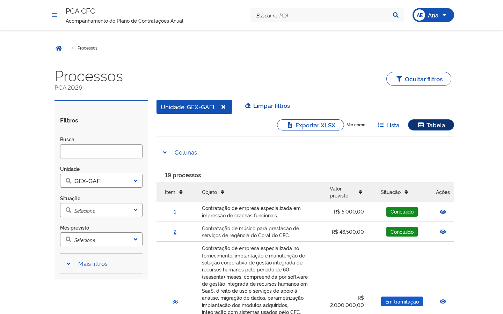
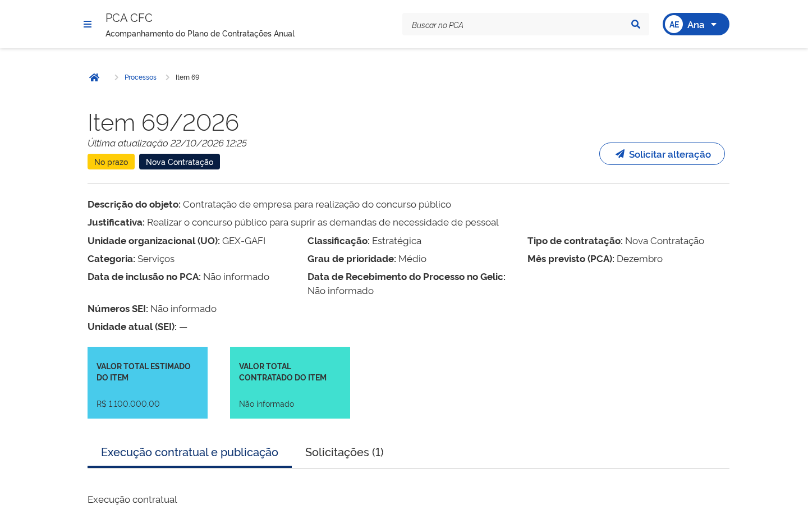
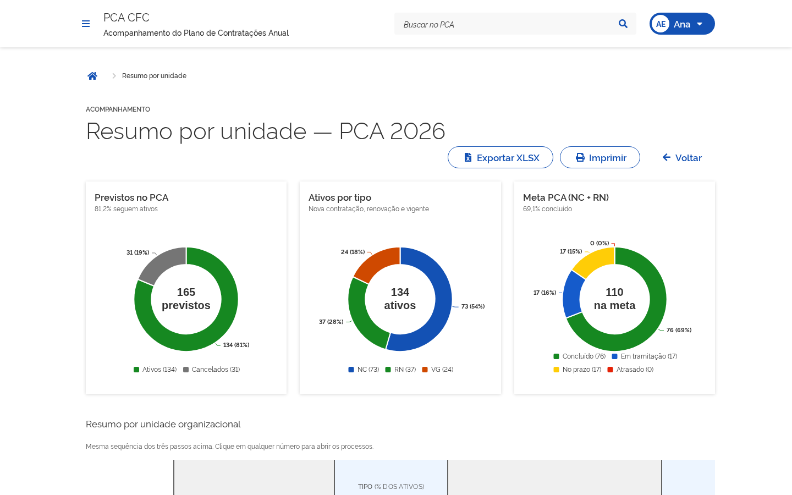
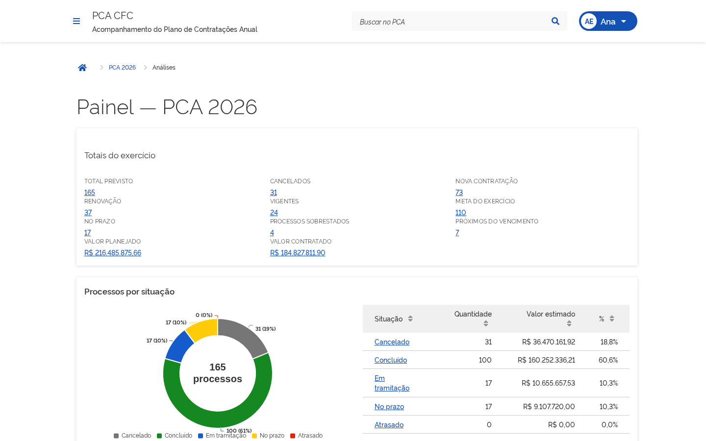

# Consultar os itens

## Processos: a lista de itens

Em **Processos** ficam todos os itens do PCA do ano. Use o painel **Filtros**, à esquerda, para
encontrar o que procura:

- **Busca** — por número do item, palavra do objeto, unidade ou número do processo SEI.
- **Unidade**, **Situação** e **Mês previsto** — filtros rápidos. Em **Mais filtros** há outros
  (tipo, categoria, prioridade e mais).
- Os filtros em uso aparecem acima da lista, como etiquetas azuis. Clique no **×** de uma etiqueta
  para tirá-la, ou em **Limpar filtros** para tirar todas.
- **Ocultar filtros**, no alto à direita, esconde o painel de filtros para a lista ocupar a tela toda.

<figure markdown="span">
  
  <figcaption>Processos filtrados pela unidade: os filtros à esquerda e, à direita, a etiqueta do
  filtro em uso, os botões da lista e os itens.</figcaption>
</figure>

Acima da lista ficam os botões:

- **Exportar XLSX** — baixar a lista, com os filtros em uso, numa planilha;
- **Ver como: Lista** ou **Tabela** — dois jeitos de ver os mesmos itens;
- **Colunas** — abre a escolha das informações que aparecem na tabela.

A lista mostra quantos processos o filtro encontrou e, no fim da página, a soma do valor estimado
deles. Em **Exibir**, no rodapé da tabela, você escolhe quantos itens aparecem por página. Clique no
título de uma coluna para ordenar por ela. Clique no número do item (ou no ícone de olho, em
**Ações**) para abrir a **ficha do item**.

## A ficha do item

No alto da ficha ficam o número do item, a data da última atualização e as etiquetas da **situação**
e do tipo de contratação. Logo abaixo vêm os dados do planejamento e do processo: descrição do
objeto, justificativa, unidade, classificação, tipo, categoria, prioridade, mês previsto, data de
inclusão no PCA, data de recebimento do processo no Gelic, números SEI e a unidade do SEI em que o
processo está. Os dois quadros coloridos mostram o **valor total estimado** e o **valor total
contratado** do item.

<figure markdown="span">
  
  <figcaption>Ficha do item. Para quem é da unidade do item, aparece o botão Solicitar
  alteração.</figcaption>
</figure>

Mais abaixo ficam as abas:

- **Execução contratual e publicação** — modalidade, número da contratação, fornecedor, contrato,
  vigência e valores, e as datas de publicação;
- **Solicitações** — os pedidos feitos sobre o item (veja [Acompanhar o andamento](acompanhar.md)).

No fim da ficha, **Voltar** retorna à tela anterior e **‹ Anterior** e **Próximo ›** passam para o item
vizinho. Se o item é da sua unidade, o botão **Solicitar alteração**, no alto, leva direto ao pedido
(veja [Solicitações](solicitacoes.md)).

## Resumo por unidade

O **Resumo por unidade** mostra os números do PCA separados por unidade. No alto, três gráficos:
**Previstos no PCA**, **Ativos por tipo** e **Meta PCA (NC + RN)** (novas contratações e
renovações). Abaixo, a tabela **Resumo por unidade organizacional** mostra, para cada unidade,
quantos itens ela tem previstos, cancelados e ativos, de que tipo e em que situação. Clique em
qualquer número para abrir os itens que ele conta. **Análise complementar**, no fim, abre mais
detalhes.

**Exportar XLSX** baixa o resumo numa planilha e **Imprimir** gera uma versão para papel.

<figure markdown="span">
  
  <figcaption>Resumo por unidade: os três gráficos do alto e, abaixo, a tabela por
  unidade.</figcaption>
</figure>

## Análises → Painel

O **Painel** reúne os indicadores do PCA:

- **Totais do exercício** — total previsto, cancelados, novas contratações, renovações, vigentes,
  meta do exercício, no prazo, sobrestados, próximos do vencimento e os valores planejado e
  contratado (cada número abre os itens que ele conta);
- **Processos por situação** — o gráfico e a tabela com quantidade e valor de cada situação;
- **Perfil do PCA** — a distribuição dos itens pela dimensão que você escolher (categoria, tipo e
  outras), com **Aplicar**;
- **Distribuição mensal por dimensão** — os itens mês a mês.

**Imprimir** gera uma versão para papel.

<figure markdown="span">
  
  <figcaption>Análises → Painel: os totais do exercício e, abaixo, os processos por
  situação.</figcaption>
</figure>
