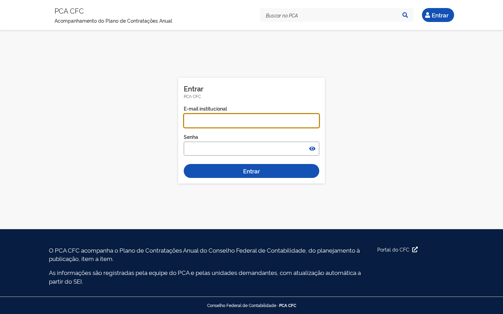
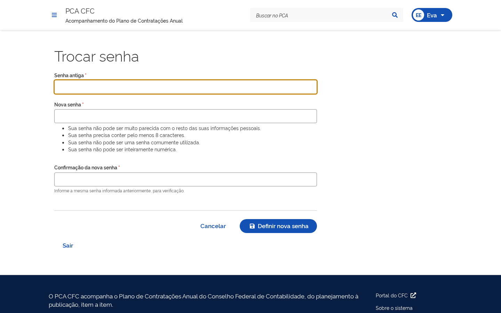

# Entrar no sistema

## Como entrar

1. Abra **<https://pca.sistemascfc.org>** no navegador (no computador ou no celular).
2. No quadro **Entrar**, informe o seu **e-mail institucional** e a sua **senha**.
3. Clique em **Entrar**.

<figure markdown="span">
  
  <figcaption>A tela de entrada: e-mail institucional e senha. O ícone de olho, dentro do campo
  Senha, mostra a senha digitada.</figcaption>
</figure>

Se a senha for digitada errada várias vezes seguidas, o acesso fica **bloqueado por alguns
minutos**. Espere e tente de novo com calma.

## Primeiro acesso: troca de senha

Quando a sua conta é criada (ou quando você recebe uma senha nova), o sistema abre a tela **Trocar
senha** antes de qualquer outra.

1. Em **Senha antiga**, digite a senha que você recebeu.
2. Em **Nova senha**, escolha uma senha sua. Ela precisa ter pelo menos 8 caracteres, não pode ser só
   números, nem parecida com o seu nome ou e-mail, nem uma senha muito comum.
3. Repita a nova senha em **Confirmação da nova senha** e clique em **Definir nova senha**.

<figure markdown="span">
  
  <figcaption>No primeiro acesso, o sistema pede uma senha nova antes de qualquer outra
  tela.</figcaption>
</figure>

## Esqueci a senha

O sistema não tem a opção "esqueci a senha". Peça uma senha nova à **equipe do PCA**: você recebe
uma senha provisória e, no próximo acesso, o sistema pede que você a troque.

## Sair

Clique no botão com o seu nome, no canto superior direito, e escolha **Sair**. Por segurança, a
sessão também termina sozinha depois de algumas horas e quando o navegador é fechado.

!!! tip "Instalar como aplicativo"
    O PCA CFC pode ser instalado no celular ou no computador como um aplicativo: no navegador, use a
    opção **Instalar aplicativo** ou **Adicionar à tela inicial**.
