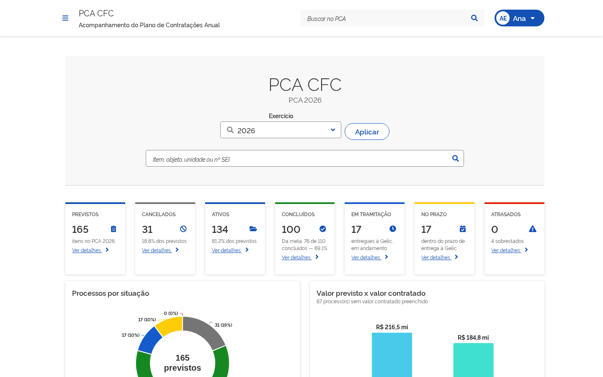
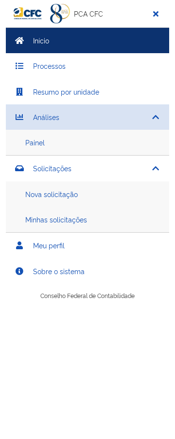
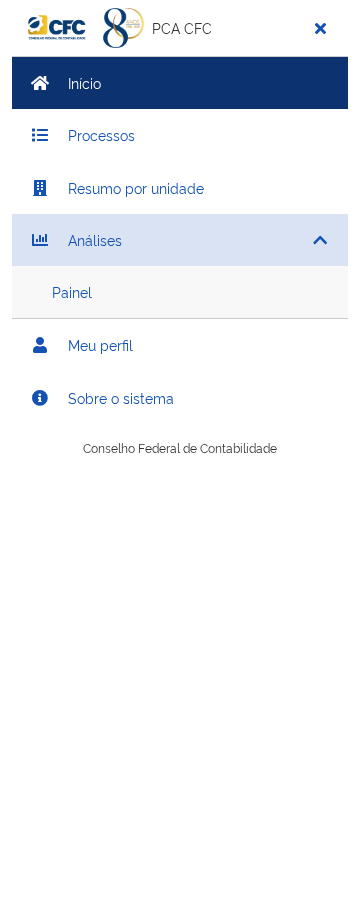

# Página inicial e menu

## O cabeçalho

No alto de todas as telas fica o cabeçalho do sistema:

- à esquerda, o botão **☰**, que abre o menu, e o nome do sistema;
- no centro, a busca **Buscar no PCA**, que procura um item pelo número, pelo objeto, pela unidade ou
  pelo número do processo SEI;
- à direita, o botão com o **seu nome**, que abre **Meu perfil** e **Sair**.

No rodapé de todas as telas ficam os links **Portal do CFC** e **Sobre o sistema**.

## A página inicial

Depois de entrar, você chega à **página inicial**: um painel com os números do PCA do ano.

<figure markdown="span">
  
  <figcaption>A página inicial: a escolha do exercício e a busca no alto e, abaixo, os cartões com os
  números do PCA do ano.</figcaption>
</figure>

- No alto, em **Exercício**, você escolhe o ano do PCA e clica em **Aplicar**. Logo abaixo, o campo
  de busca procura por item, objeto, unidade ou número SEI.
- Os **cartões** mostram quantos itens estão previstos no PCA, quantos foram cancelados, quantos
  estão ativos, concluídos, em tramitação, no prazo e atrasados. **Ver detalhes**, em cada cartão,
  abre a lista desses itens.
- **Processos por situação** e **Valor previsto x valor contratado** são gráficos; em **Ver dados**
  você vê os números de cada gráfico numa tabela. **Mais informações no painel de Análises** leva ao
  Painel.
- **Processos sobrestados** lista os itens cujo prazo de entrega já foi adiado mais de uma vez
  (**Ver todos** abre a lista completa).
- **Acesso rápido** tem atalhos para as telas mais usadas.

Clique em qualquer número de item para abrir a ficha dele.

## O menu

O menu fica escondido para dar espaço às telas. Clique no botão **☰**, no canto superior esquerdo,
para abri-lo, e no **×** para fechá-lo. As pastas, como **Análises** e **Solicitações**, abrem com um
clique e mostram as telas que estão dentro delas.

<figure markdown="span">
  
  <figcaption>Menu de quem é de uma unidade, com as pastas Análises e Solicitações
  abertas.</figcaption>
</figure>

Para quem é de uma unidade, o menu traz:

| Opção | Para quê |
|---|---|
| **Início** | A página inicial, com os números do PCA |
| **Processos** | A lista de todos os itens do PCA, com busca e filtros |
| **Resumo por unidade** | Os números do PCA separados por unidade |
| **Análises → Painel** | Gráficos e indicadores do PCA |
| **Solicitações → Nova solicitação** | Pedir alteração, cancelamento ou inclusão de item |
| **Solicitações → Minhas solicitações** | Acompanhar os pedidos da sua unidade |
| **Meu perfil** | Os seus dados e a troca de senha |
| **Sobre o sistema** | Informações sobre o PCA CFC |

No perfil de **leitura**, o menu é o mesmo, mas **sem a pasta Solicitações**: quem só acompanha o
PCA não faz pedidos.

<figure markdown="span">
  
  <figcaption>Menu do perfil de leitura: sem a pasta Solicitações.</figcaption>
</figure>

Quando estiver ligado, o menu traz também o **Assistente de IA**, em que você pode fazer perguntas
sobre o PCA em linguagem comum.
