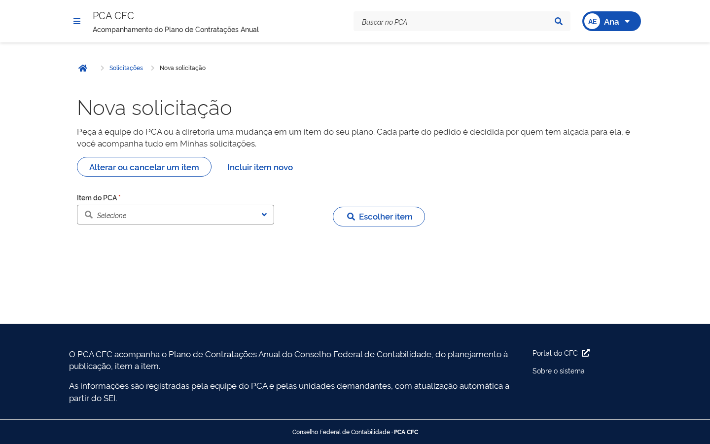
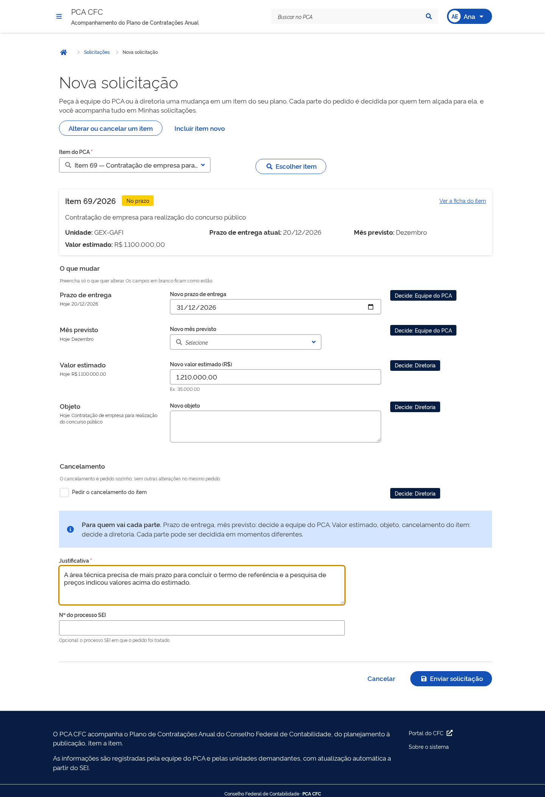
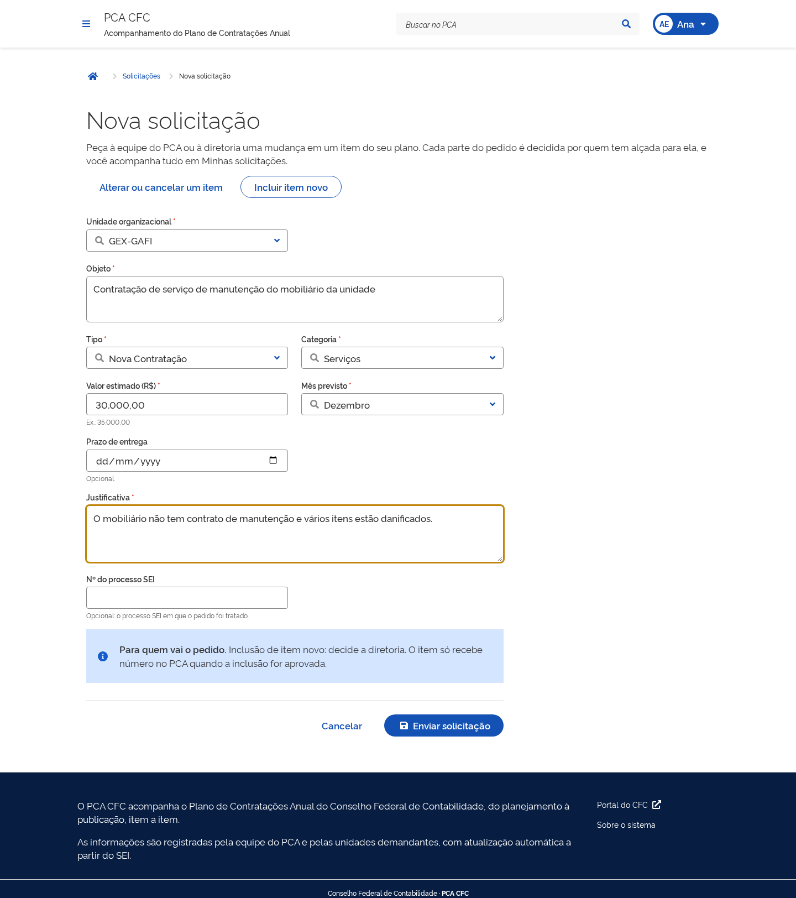
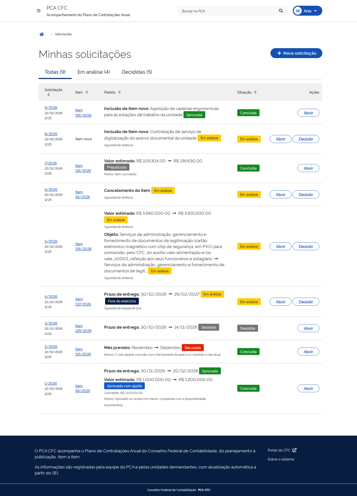
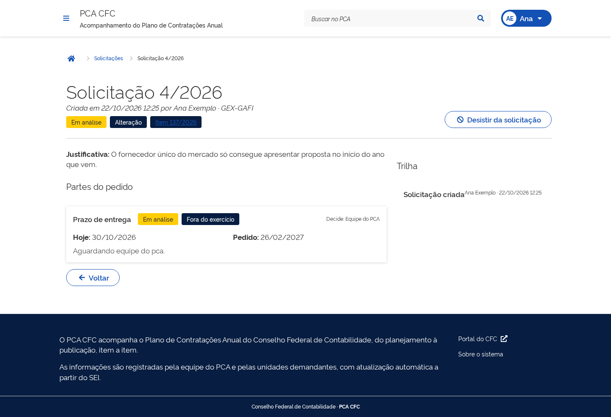
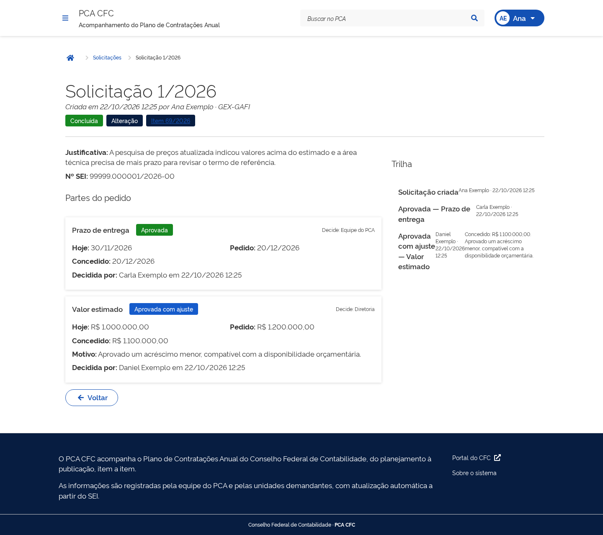

# Solicitações

As **Solicitações** são o caminho, dentro do sistema, para a sua unidade pedir uma mudança no PCA —
em vez do e-mail, do telefone ou do pedido feito na reunião. Cada pedido fica registrado com quem
pediu, por quê, quem decidiu e quando.

Para fazer pedidos, você precisa ter o perfil de **unidade (solicitante)** e estar ligado a pelo
menos uma unidade (quem faz essa ligação é o administrador do sistema). Você só pode pedir nos
itens das **suas** unidades.

## O que pedir e quem decide

| Pedido | O que é | Quem decide |
|---|---|---|
| **Prazo de entrega** | Nova data para entregar o processo do item à Gelic | Equipe do PCA |
| **Mês previsto** | Novo mês da contratação (de janeiro a dezembro) | Equipe do PCA |
| **Valor estimado** | Novo valor estimado do item | Diretoria |
| **Objeto** | Nova descrição do objeto | Diretoria |
| **Cancelamento do item** | Tirar o item do PCA | Diretoria |
| **Inclusão de item novo** | Incluir no PCA um item que ainda não existe | Diretoria |

Uma solicitação trata de **um item** e pode juntar vários pedidos (por exemplo, prazo e valor ao
mesmo tempo). Cada pedido é uma **parte** da solicitação e é decidido separadamente, pela sua alçada,
na hora em que ela decidir — uma parte pode ser decidida antes da outra.

## Começar uma solicitação

Abra **Solicitações → Nova solicitação** e escolha o que quer fazer:

- **Alterar ou cancelar um item** — escolha o item em **Item do PCA** (dá para digitar parte do
  número ou do objeto para encontrá-lo) e clique em **Escolher item**;
- **Incluir item novo** — pedir um item que ainda não está no PCA.

<figure markdown="span">
  
  <figcaption>Nova solicitação: alterar ou cancelar um item, ou incluir um item novo.</figcaption>
</figure>

Outro caminho: na ficha de um item da sua unidade, clique em **Solicitar alteração**, no alto. A
tela já abre com o item escolhido.

## Pedir uma alteração

1. Escolha o item. A tela mostra a situação dele e o **prazo de entrega**, o **mês previsto** e o
   **valor estimado** de hoje.
2. Em **O que mudar**, preencha **só o que quer alterar**. Os campos em branco ficam como estão. Ao
   lado de cada campo aparece quem decide aquele pedido.
3. Escreva a **justificativa** (obrigatória). Se o pedido já tramita num processo SEI, informe o
   **número do processo SEI** (opcional).
4. Clique em **Enviar solicitação**. A solicitação ganha um número no formato **N/AAAA** e fica
   **Em análise**.

<figure markdown="span">
  
  <figcaption>Pedido de alteração do prazo de entrega e do valor estimado, preenchido: cada campo
  indica quem decide.</figcaption>
</figure>

## Pedir o cancelamento de um item

O cancelamento é pedido **sozinho**, sem outras alterações no mesmo pedido. Na mesma tela do pedido
de alteração, marque **Pedir o cancelamento do item** no bloco **Cancelamento**, escreva a
justificativa e envie. Quem decide é a diretoria.

<figure markdown="span">
  
  <figcaption>O bloco Cancelamento: o pedido de cancelamento vai sozinho, sem outras
  alterações.</figcaption>
</figure>

## Pedir a inclusão de um item novo

Em **Nova solicitação**, clique em **Incluir item novo** e informe:

- a **unidade** a que o item vai pertencer (se você é de mais de uma);
- o **objeto**, o **tipo** (Nova Contratação ou Renovação) e a **categoria**;
- o **valor estimado** e o **mês previsto**;
- o **prazo de entrega** (opcional) e a **justificativa**;
- o **número do processo SEI**, se houver (opcional).

<figure markdown="span">
  
  <figcaption>Pedido de inclusão de item novo, preenchido.</figcaption>
</figure>

Quem decide é a diretoria. O item só ganha número no PCA **depois de aprovado**: até lá, a
solicitação aparece como **Item novo**.

## O que cada item aceita

Nem todo item aceita todo pedido. Depende da situação dele:

- O **exercício** do item precisa estar aberto e o item precisa estar **ativo** (não cancelado).
- **Prazo de entrega e mês previsto** só podem ser pedidos em item que ainda vai ser entregue à Gelic
  (**No prazo** ou **Atrasado**).
- **Valor, objeto e cancelamento** podem ser pedidos em qualquer item ativo que ainda não foi
  **concluído**.
- Pode pedir um prazo **depois de 31/12** do ano do PCA: o pedido é aceito, mas fica marcado como
  **Fora do exercício** para quem decide.
- Só pode haver **um pedido em análise para cada campo** de um item. Se já há um pedido de prazo em
  análise, por exemplo, espere a decisão para pedir outro prazo. Enquanto houver um pedido de
  **cancelamento** em análise, o item não recebe nenhum outro pedido.

A tela do pedido só mostra os campos que o item aceita naquele momento e avisa quando já há pedido
em análise.

## Minhas solicitações

Em **Solicitações → Minhas solicitações** ficam as solicitações da sua unidade — todas as pessoas da
unidade veem os pedidos da unidade, não só os próprios. As abas separam **Todas**, **Em análise** e
**Decididas**, cada uma com o número de solicitações entre parênteses. O botão **Nova solicitação**,
no alto, abre um pedido novo.

<figure markdown="span">
  
  <figcaption>Minhas solicitações: cada linha é uma solicitação, com as partes, a situação de cada
  uma e, nas decididas com ajuste ou recusa, o motivo.</figcaption>
</figure>

Cada parte mostra a sua situação numa etiqueta e, enquanto está em análise, quem precisa decidir
("Aguardando diretoria", "Aguardando equipe do PCA"). Clique em **Abrir** para ver a solicitação
inteira. Na ficha do item, a aba **Solicitações** reúne as solicitações daquele item.

## Ver uma solicitação e desistir

A tela da solicitação mostra, no alto, quem criou e quando e as etiquetas da situação, do tipo e do
item. Abaixo vêm a justificativa, o número SEI (se houver), as **Partes do pedido** — cada uma com o
valor de **Hoje** e o valor **Pedido** — e, ao lado, a **Trilha**: quem fez o quê e quando.

<figure markdown="span">
  
  <figcaption>Solicitação em análise, marcada como fora do exercício, com o botão Desistir da
  solicitação.</figcaption>
</figure>

Não há como editar uma solicitação enviada. Se você errou ou mudou de ideia, use **Desistir da
solicitação** (na tela da solicitação ou no botão **Desistir** da lista) e faça um pedido novo. A
desistência fica registrada. As partes que já foram decididas não voltam atrás.

Depois da decisão, a tela mostra, em cada parte, o que foi **Concedido**, o **Motivo** (nos ajustes e
recusas) e **Decidida por** quem e quando.

<figure markdown="span">
  
  <figcaption>Solicitação decidida: o prazo foi aprovado pela equipe do PCA e o valor foi aprovado
  com ajuste pela diretoria, com o valor concedido e o motivo.</figcaption>
</figure>

## As situações de cada parte

| Situação | O que quer dizer |
|---|---|
| **Em análise** | Aguardando a decisão da equipe do PCA ou da diretoria |
| **Aprovada** | Aprovada como foi pedida; já vale no item |
| **Aprovada com ajuste** | Aprovada com outro valor, data, mês ou objeto, com o motivo; o que vale no item é o concedido |
| **Recusada** | Recusada, com o motivo |
| **Prejudicada** | O item foi cancelado ou concluído por outro caminho enquanto o pedido estava em análise |
| **Desistida** | A unidade desistiu do pedido |

A solicitação inteira fica **Concluída** quando todas as partes têm um desfecho, ou **Desistida**
quando a unidade desistiu de tudo.

!!! info "Não há aviso por e-mail"
    O sistema não manda e-mail quando um pedido é decidido. Acompanhe os seus pedidos em **Minhas
    solicitações** ou na aba **Solicitações** da ficha do item.
