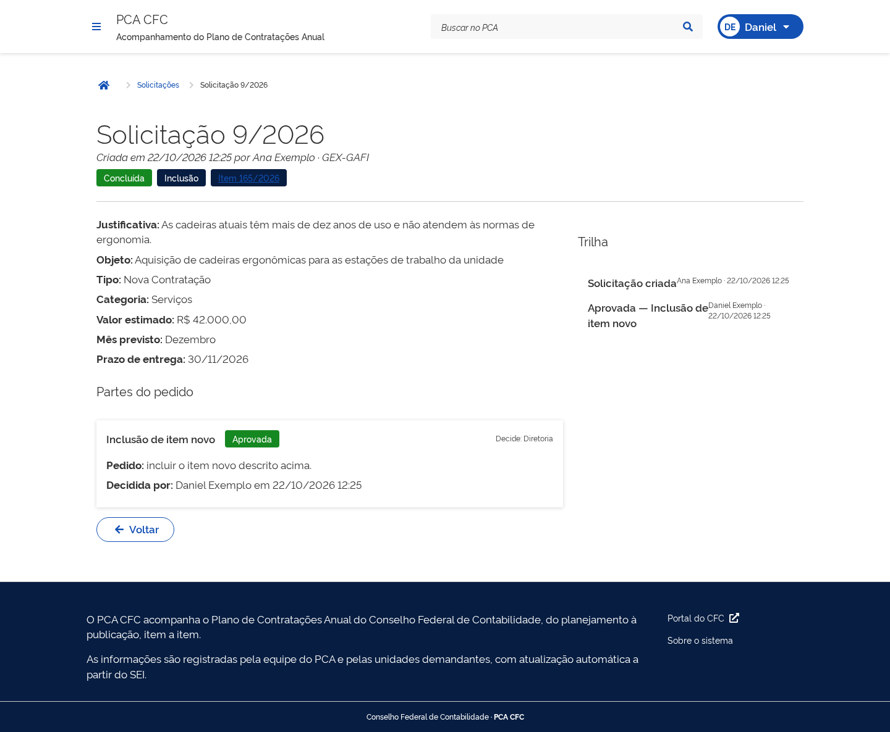
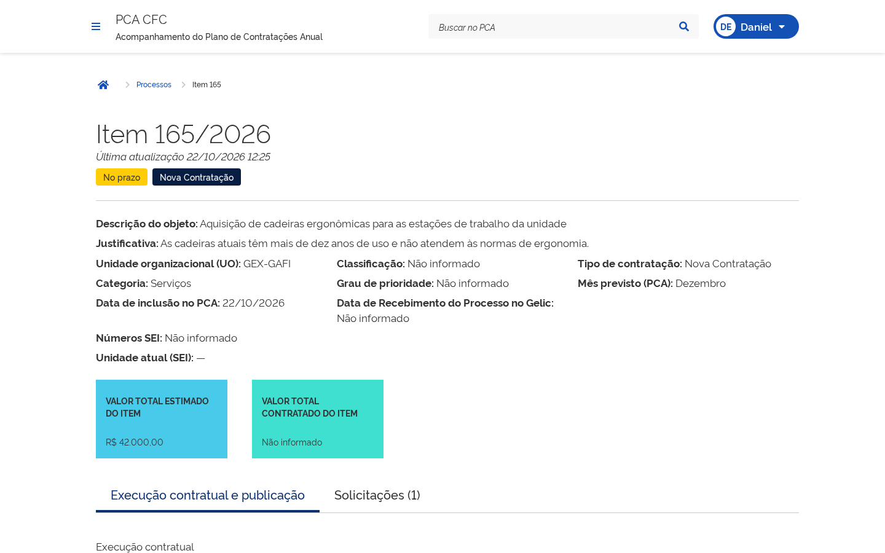
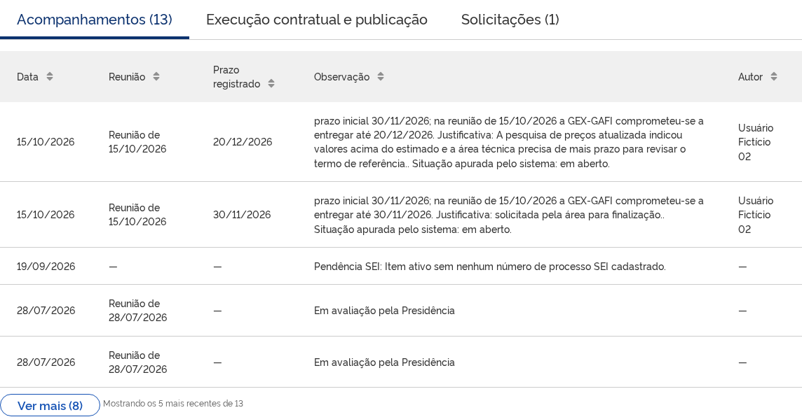
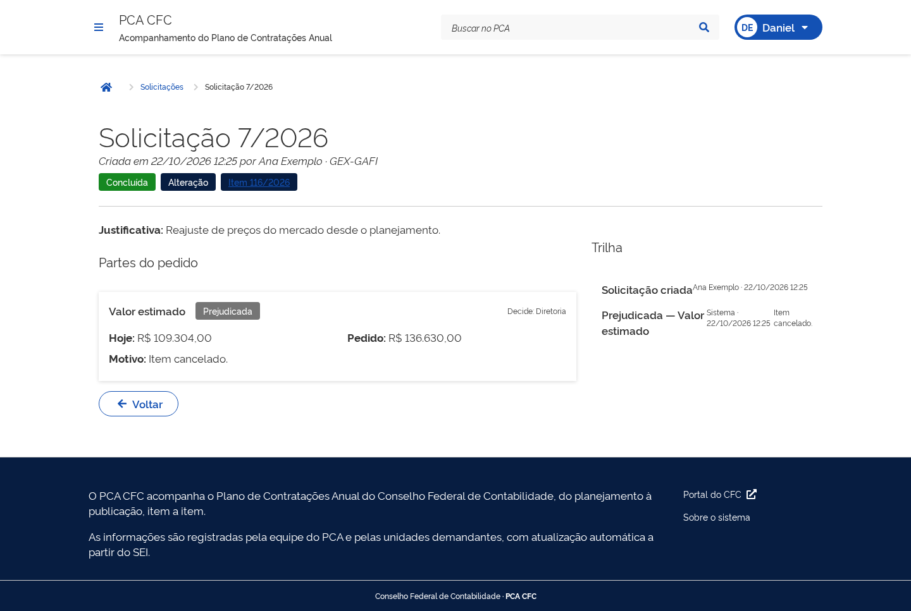
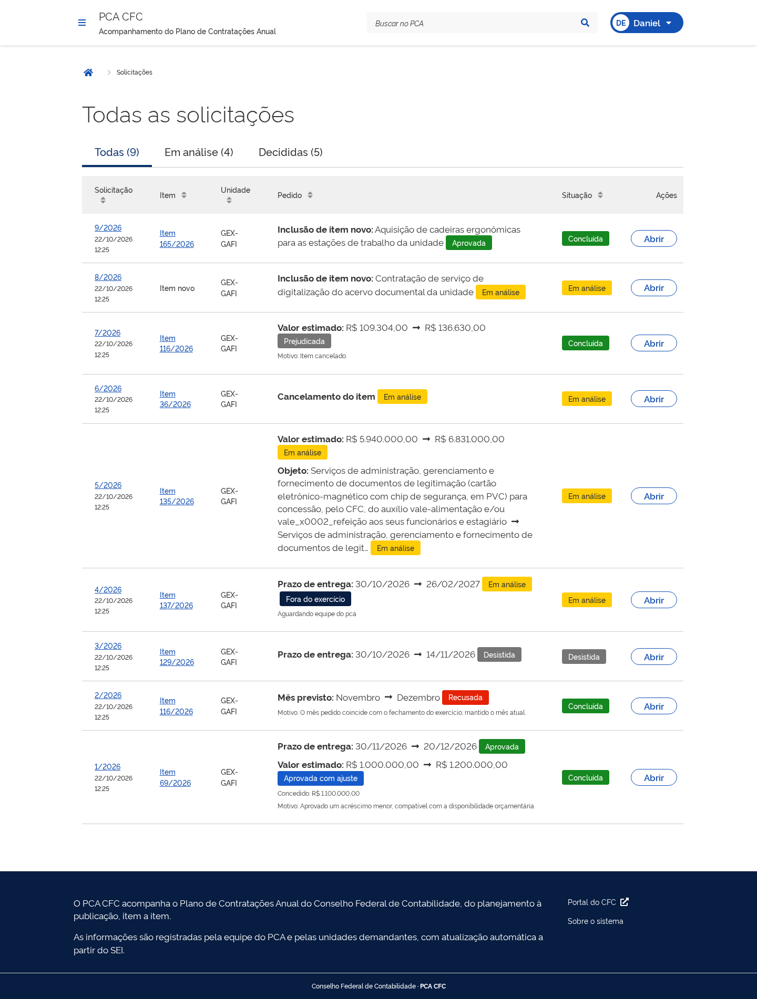

# Inclusão de itens e efeitos da aprovação

O que se aprova **vale na hora**: o sistema atualiza o item no momento em que a decisão é
registrada, sem passo adicional.

## Inclusão de itens no PCA

Quando a diretoria aprova um pedido de **inclusão de item novo**, o sistema **cria o item no PCA**
com o **próximo número** disponível e com os dados que a unidade informou: objeto, tipo, categoria,
valor estimado, mês previsto, prazo de entrega (se informado), unidade e justificativa. A
solicitação passa a apontar o item criado.

<figure markdown="span">
  
  <figcaption>Inclusão aprovada: a solicitação aponta o item criado (no alto, na etiqueta ao lado de
  Inclusão) e a trilha registra a aprovação.</figcaption>
</figure>

<figure markdown="span">
  
  <figcaption>O item criado pela inclusão, já no PCA com o próximo número.</figcaption>
</figure>

O **número do processo SEI** informado no pedido de inclusão fica na solicitação, mas **não é
ligado ao item novo**: quem faz essa ligação é a equipe do PCA.

## O que cada aprovação muda no item

| Pedido aprovado | O que acontece no item |
|---|---|
| **Prazo de entrega** | O novo prazo é registrado como um acompanhamento do item. Conta como prorrogação e aparece como prazo repactuado |
| **Mês previsto**, **valor estimado** ou **objeto** | O campo do item é atualizado; o histórico do item guarda a solicitação como motivo da alteração |
| **Cancelamento** | O item passa a **Cancelado**, com o motivo |
| **Inclusão** | O item é criado no PCA, como descrito acima |

Na aprovação com ajuste, o que vale no item é o valor **concedido**, não o pedido.

A equipe do PCA vê o prazo aprovado na aba **Acompanhamentos** da ficha do item:

<figure markdown="span">
  
  <figcaption>Aba Acompanhamentos da ficha do item (tela da equipe do PCA): o prazo aprovado entra
  como acompanhamento, com a justificativa da unidade.</figcaption>
</figure>

## Pedidos prejudicados

Se um item é **cancelado** ou **concluído por outro caminho** — pela equipe do PCA, pelo
administrador ou pela sincronização com o SEI — enquanto há partes em análise sobre ele, essas partes
terminam como **Prejudicada**, sem decisão. Não é preciso fazer nada: elas saem da fila sozinhas.

<figure markdown="span">
  
  <figcaption>Parte prejudicada: o item foi cancelado enquanto o pedido de valor estava em
  análise.</figcaption>
</figure>

## Todas as solicitações

Quem decide (equipe do PCA e diretoria) tem, em **Solicitações → Todas as solicitações**, a lista de
**todas** as solicitações de todas as unidades, com as abas **Todas**, **Em análise** e
**Decididas** — inclusive as que não são da sua alçada, para consulta.

<figure markdown="span">
  
  <figcaption>Todas as solicitações: cada linha com a unidade, as partes, a situação de cada uma e
  os motivos.</figcaption>
</figure>
