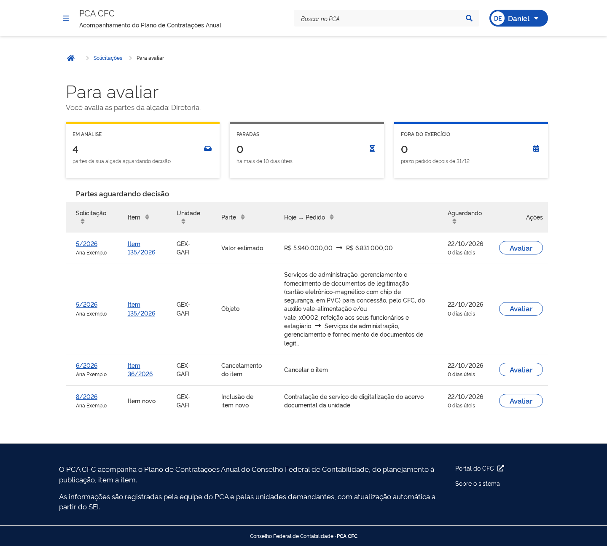
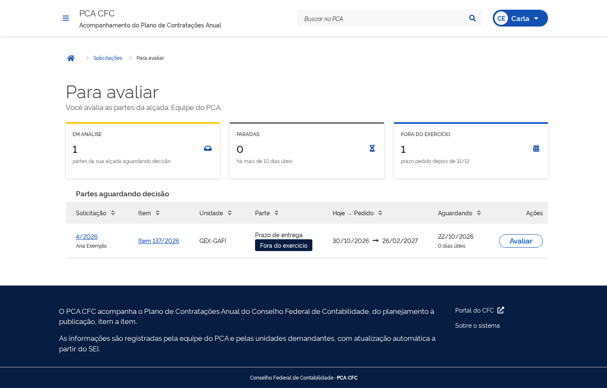
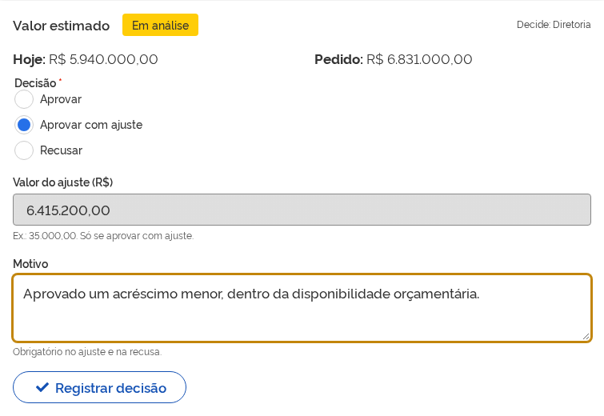
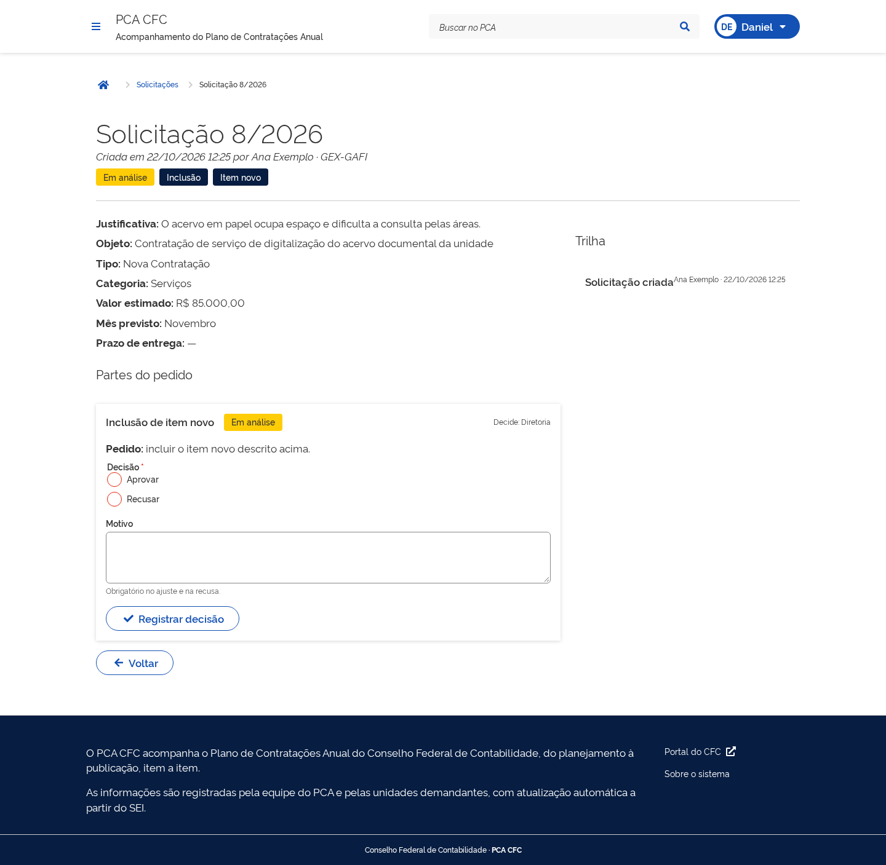

# Avaliar solicitações

## A fila Para avaliar

Em **Solicitações → Para avaliar** ficam as partes de pedido da **sua alçada** que esperam decisão.

<figure markdown="span">
  
  <figcaption>Para avaliar (diretoria): os cartões do alto e a fila de partes aguardando
  decisão.</figcaption>
</figure>

- Os **cartões do alto** mostram quantas partes estão **em análise**, quantas estão **paradas** (há
  mais de 10 dias úteis sem decisão) e quantas pedem prazo **fora do exercício** (depois de 31/12).
- A fila vem **da mais antiga para a mais nova**. As **paradas há mais de 10 dias úteis** sobem para
  o topo e ficam em destaque.
- Cada linha mostra a solicitação e quem pediu, o item, a unidade, a parte (o que foi pedido), o
  valor de **hoje → pedido** e desde quando o pedido espera, em dias úteis.
- **Avaliar**, na coluna Ações, abre a solicitação para decidir.

A **equipe do PCA** vê na mesma tela só os pedidos de **prazo** e de **mês**:

<figure markdown="span">
  
  <figcaption>Para avaliar (equipe do PCA): só prazo e mês. O pedido marcado "Fora do exercício"
  pede um prazo depois de 31/12.</figcaption>
</figure>

## Decidir uma parte

Ao abrir a solicitação, você vê a **justificativa** da unidade, o **número SEI** (se informado), a
**Trilha** (quem fez o quê e quando) e, em **Partes do pedido**, cada parte com o valor de **Hoje** e o
**Pedido**. Nas partes da sua alçada, escolha a **Decisão**:

- **Aprovar** — o pedido vale como foi feito, na hora.
- **Aprovar com ajuste** — você concede outro valor, outra data, outro mês ou outro objeto. Informe o
  valor do ajuste e o **motivo** (obrigatório).
- **Recusar** — o pedido não vale. O **motivo** é obrigatório.

Depois, clique em **Registrar decisão**. Cada parte tem o seu botão: decida uma de cada vez.

<figure markdown="span">
  
  <figcaption>Decisão de uma parte de valor estimado: Aprovar com ajuste, com o valor concedido e o
  motivo preenchidos.</figcaption>
</figure>

O ajuste precisa ser diferente do pedido: se for igual, use **Aprovar**.

## Cancelamento e inclusão: só aprovar ou recusar

Nos pedidos de **cancelamento do item** e de **inclusão de item novo** não há o que ajustar: as
opções são só **Aprovar** e **Recusar**. Na inclusão, a tela mostra tudo o que a unidade informou
(objeto, tipo, categoria, valor, mês e prazo).

<figure markdown="span">
  
  <figcaption>Pedido de inclusão de item novo: só aprovar ou recusar.</figcaption>
</figure>

## Quando a solicitação fecha

A solicitação fica **Em análise** até que **todas** as partes tenham um desfecho. Quando a última
parte é decidida, ela passa a **Concluída** e sai da fila. As partes já decididas não podem ser
mudadas pela tela; uma correção excepcional é feita pelo administrador do sistema.
