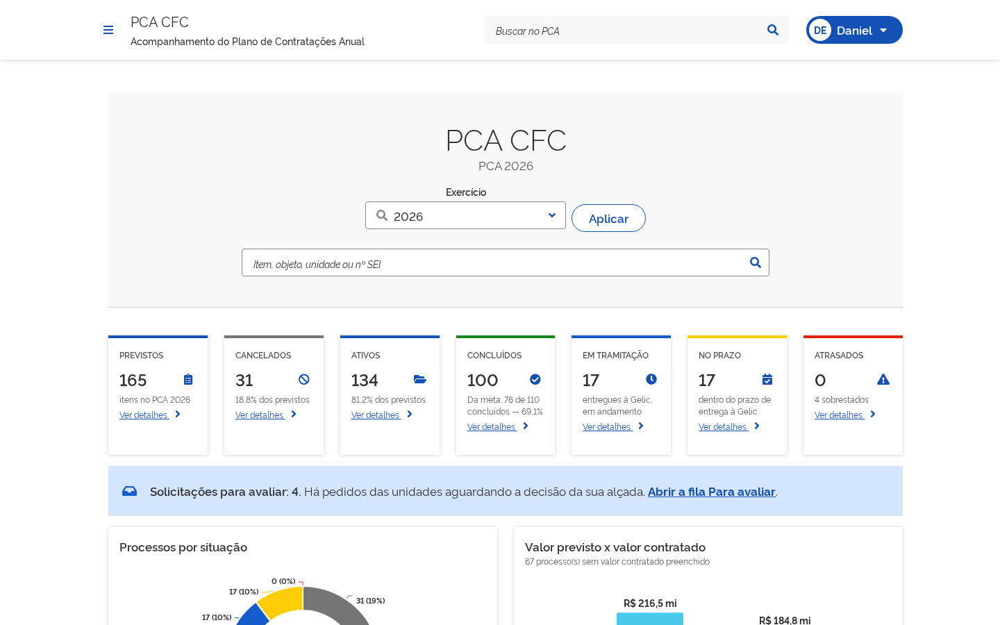
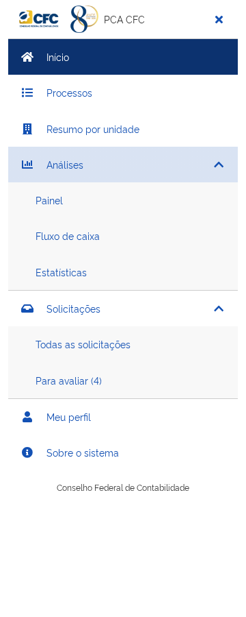

# Alçadas e contadores

Esta parte do manual é para quem **decide** os pedidos das unidades: a **diretoria** e a **equipe do
PCA**. As unidades pedem pelo sistema (veja [Solicitações](../areas/solicitacoes.md)); quem decide
avalia cada pedido também pelo sistema, a qualquer hora, sem esperar a reunião mensal.

## Quem decide o quê

Cada pedido é decidido por uma **alçada**:

| Pedido da unidade | Quem decide |
|---|---|
| Prazo de entrega | Equipe do PCA |
| Mês previsto | Equipe do PCA |
| Valor estimado | Diretoria |
| Objeto | Diretoria |
| Cancelamento do item | Diretoria |
| Inclusão de item novo | Diretoria |

Cada pessoa decide **só a sua alçada**: a equipe do PCA vê e decide só os pedidos de prazo e mês; a
diretoria, só os de valor, objeto, cancelamento e inclusão. Quem está nas duas decide tudo.

Uma solicitação pode juntar pedidos das duas alçadas (por exemplo, prazo e valor no mesmo item).
Cada **parte** é decidida por quem tem alçada para ela, no momento em que decidir — a equipe pode
aprovar o prazo hoje e a diretoria decidir o valor na semana seguinte.

## Delegação

Quem entra na diretoria para decidir os pedidos é definido pelo **administrador do sistema**: para
delegar a decisão a outra pessoa, peça ao administrador que a inclua na alçada da diretoria (ou que
a retire, quando a delegação terminar).

## Onde aparecem os pedidos a decidir

Há dois avisos, sempre com o número de pedidos da **sua** alçada esperando decisão:

- na **página inicial**, o aviso **Solicitações para avaliar**, logo abaixo dos cartões, com o link
  **Abrir a fila Para avaliar**;
- no menu (botão **☰**, no canto superior esquerdo), em **Solicitações → Para avaliar (N)**.

<figure markdown="span">
  
  <figcaption>Página inicial da diretoria, com o aviso de solicitações para avaliar logo abaixo dos
  cartões.</figcaption>
</figure>

<figure markdown="span">
  
  <figcaption>Menu da diretoria: em Solicitações, Todas as solicitações e Para avaliar com o
  número de pendências; em Análises, Painel, Fluxo de caixa e Estatísticas.</figcaption>
</figure>

O sistema não manda e-mail: o contador do menu e o aviso da página inicial são a forma de saber que
há pedidos esperando.
