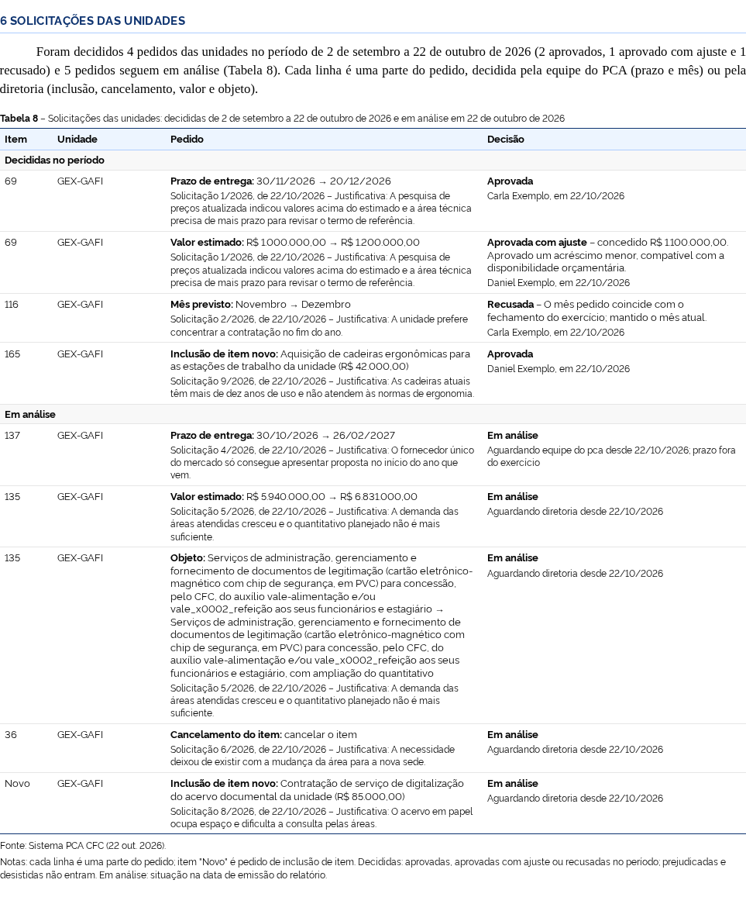
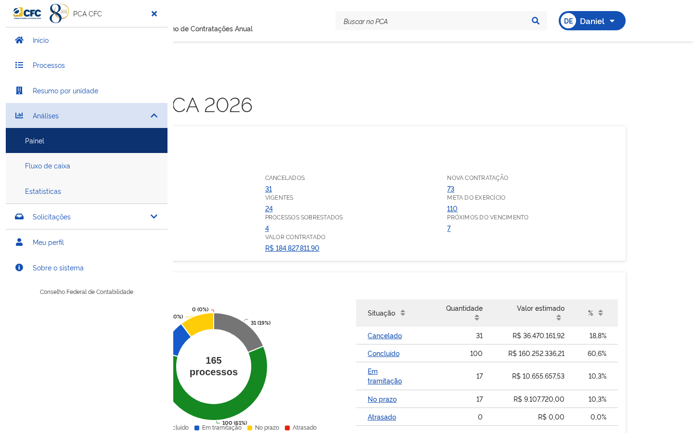

# Relatório da reunião e análises

## A seção Solicitações das unidades

O **relatório da reunião mensal** de acompanhamento tem a seção **Solicitações das unidades**, com:

- os pedidos **decididos no período** do relatório — aprovados, aprovados com ajuste e recusados,
  com a decisão, o motivo, quem decidiu e quando;
- os pedidos que seguem **em análise** na data de emissão do relatório, com quem precisa decidir.

Cada linha é uma parte do pedido, com o item, a unidade, o pedido (de → para) e a justificativa. Os
pedidos **prejudicados** e **desistidos** não entram.

<figure markdown="span">
  
  <figcaption>A seção Solicitações das unidades do relatório da reunião: decididas no período e em
  análise na data de emissão.</figcaption>
</figure>

O relatório é aberto em **Relatório da reunião**, no menu da **equipe do PCA**, que escolhe o
exercício e a reunião, ou um período livre (**Aplicar filtro**), e pode **Baixar PDF**, **Copiar relatório** ou
**Baixar HTML**. Se o seu menu não tem **Relatório da reunião**, peça o relatório à equipe do PCA.

## Como o relatório se apresenta

O documento inteiro usa **uma única fonte, a Calibri**: o texto corrido em tamanho 12 e as tabelas em
tamanho menor (os anexos, menor ainda). Em computadores sem a Calibri, como alguns de Linux, o
navegador usa uma fonte parecida e o desenho não muda.

Na seção **Situação do PCA** o relatório mostra:

- **quatro cartões** lado a lado, cada um com um número grande e o nome da situação: **Concluído**,
  **Em tramitação**, **No prazo** e **Atrasado** (este em vermelho, para chamar a atenção). Os cartões
  são o **Quadro 2** do relatório da reunião (no relatório de período, o **Quadro 1**). No celular eles
  se arrumam em duas linhas de dois;
- o **Gráfico 1**, com duas colunas, o **valor previsto** e o **valor contratado**, e o valor em milhões
  de reais escrito em cima de cada uma;
- o **Gráfico 2**, com **uma coluna por unidade**, dividida em **concluído**, **em tramitação** e
  **a entregar à Gelic**, o total de itens em cima e o nome da unidade embaixo. Aparecem todas as
  unidades que têm itens ativos; só quando passam de 20 as menores se juntam numa coluna **"Outras N
  unidades"**, e a nota abaixo do gráfico diz quais são.

Os itens tratados por unidade e os itens incluídos no PCA aparecem **só nas tabelas**, sem gráfico.

As reuniões antigas também ganham esse desenho, com os mesmos números (veja **Visual sempre atual**, mais
abaixo).

## Reunião fechada: o relatório fica congelado

Quando a reunião é **fechada**, o sistema guarda uma **cópia do relatório que nunca mais muda**: os
números, os itens e os textos daquele dia. Abrir o relatório dessa reunião meses depois mostra essa
cópia, e não os números de hoje. No fim da página aparece o carimbo, por exemplo: **"Versão a1b2c3d ·
congelada em 06/11/2026 18:30 por Maria Souza (versão 1 de 1)"**. O código curto (a1b2c3d) identifica a
cópia: se ela fosse alterada por fora do sistema, a página avisaria e não mostraria o relatório.

- **Reunião reaberta e fechada de novo.** Nasce uma **nova versão** e as anteriores continuam guardadas.
  A tela mostra a mais recente; a lista **Versões deste relatório**, logo abaixo do documento, leva a cada
  uma das outras.
- **Reunião ainda aberta.** O relatório aparece como **prévia**, com um aviso amarelo no alto
  ("Prévia — a reunião está aberta; este relatório muda até ser fechada"). Ele é recalculado a cada
  abertura, até a reunião ser fechada.
- **Reuniões antigas.** As reuniões anteriores a **30/07/2026** vieram da planilha importada e nunca foram
  fechadas no sistema. O relatório delas foi **reconstituído** do histórico de alterações, e o carimbo
  diz isso ("reconstituída do histórico em …"), com uma observação quando o sistema ainda não tinha
  dados na data da reunião.
- **Visual sempre atual.** O que fica guardado são os dados; a aparência é a de hoje. Quando o desenho do
  relatório melhorar, as reuniões antigas ganham o desenho novo, com os mesmos números.
- **Datas escolhidas por você.** Ao preencher **De** e **Até** e usar **Aplicar filtro**, o relatório é de
  **período**, e não de uma reunião: o título é "Relatório de acompanhamento do PCA", sem o número da
  reunião e sem a seção de registros da reunião. Se a data **Até** é do passado, os dados são os de
  **como o sistema estava no último dia escolhido**, e a página diz "Dados até DD/MM/AAAA". Esse relatório
  não é guardado.

## O que a diretoria vê em Análises

Além da página inicial e do [Painel](../areas/consultar.md#analises-painel), a diretoria tem, em
**Análises**:

- **Fluxo de caixa** — a projeção, ao longo do tempo, de quanto as contratações do PCA devem custar,
  também por unidade, com uma explicação de como ler a projeção, as premissas usadas e os itens que
  ficaram fora da conta;
- **Estatísticas** — em **Valores**, a diferença entre o valor estimado e o contratado por
  modalidade, a concentração dos valores e os 10 maiores fornecedores; em **Vigência**, os
  vencimentos de contratos por trimestre e o alerta de contratos com vigência acumulada de 48 meses
  ou mais; e o **Perfil** dos itens.

<figure markdown="span">
  
  <figcaption>Análises para a diretoria: com o menu aberto, a pasta Análises mostra Painel, Fluxo de
  caixa e Estatísticas.</figcaption>
</figure>
